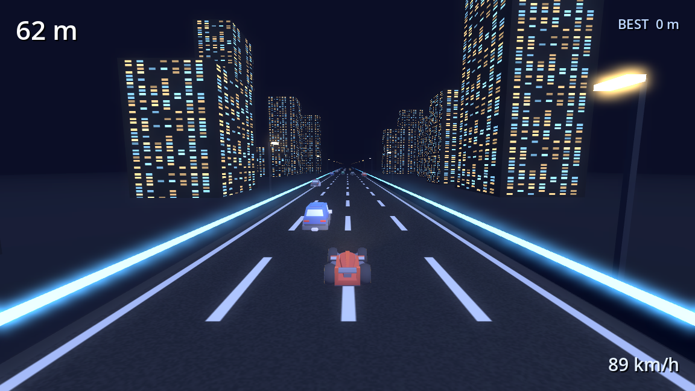

# Night Racer

An endless 3D highway racer in the spirit of *Race Master 3D* — built with
**Godot 4.7.2** and **open-source (CC0) art and audio**.

You drive up a neon-lit city highway at night. Traffic is slower than you, so it
comes at you from ahead: weave between the lanes, survive as long as you can, and
try to beat your own distance. Touch anything and the run ends.



## Play it

1. Install **Godot 4.7.2** (the engine is also published in the
   [`godot-4.7.2-ai-studio`](https://github.com/pocketagent98-ai/godot-4.7.2-ai-studio) repo).
2. Open this folder as a project in the Godot editor (`project.godot`).
3. Press **F5** to run.

There is also a pre-built **Web** version attached to this repo's Releases — unzip
it and serve the folder over a local web server (browsers block WebAssembly on
`file://`), for example:

```bash
python3 -m http.server 8080
# then open http://localhost:8080
```

## Controls

| Action | Keys |
|--------|------|
| Steer left / right | ← / → or **A** / **D** |
| Start / restart | **Space** (or tap / click) |
| Quit | **Esc** |

Touch and mouse drag also steer — the car follows your finger's horizontal motion.

## What's in the game

- **Four-lane night highway** with a scrolling road texture, glowing edge strips
  and a lit skyline that streams past.
- **Sixteen recycled traffic cars** drawn at random from eight vehicle models,
  each moving at its own speed. Spawns avoid walling off every lane.
- **Arcade feel** — speed ramps up the longer you survive; the car banks into
  turns and its wheels spin with your speed.
- **Chase camera** that eases behind the car and leans with your steering.
- **HUD** with live distance, speed in km/h and a best score saved between runs.
- **Audio** — looping engine that rises in pitch with speed, a skid cue on hard
  steering and an impact sound on collision.

## Project layout

```
.
├── project.godot
├── scenes/main.tscn          # single root node; the world is built in code
├── scripts/game.gd           # all game logic (the whole game)
├── assets/
│   ├── cars/                 # Kenney vehicle models (.glb) + shared colormap
│   ├── audio/                # engine / skid / impact
│   ├── shaders/              # scrolling road + window-lit buildings
│   └── textures/             # procedurally generated road + building textures
├── export_presets.cfg        # Web export preset
└── screenshots/
```

The entire game is `scripts/game.gd` — the scene file is one node and everything
else (environment, road, skyline, cars, camera, HUD) is constructed in `_ready()`.
That makes it easy to read and easy for an AI assistant to edit through the
[MCP bridge](https://github.com/pocketagent98-ai/godot-4.7.2-ai-studio).

## Tuning

Most of the feel lives in the constants at the top of `scripts/game.gd`:

| Constant | Meaning |
|----------|---------|
| `START_SPEED` / `MAX_SPEED` / `ACCEL` | how fast you start, how fast you top out, how quickly you get there |
| `LANES` / `ROAD_WIDTH` | number and width of lanes |
| `TRAFFIC_COUNT` | how many cars are recycled at once |
| `LATERAL_SPEED` | how quickly you move across lanes |
| `SPAWN_Z` | how far ahead traffic appears |

## Credits

Art and audio are **CC0 (public domain)** — see [CREDITS.md](CREDITS.md).
Engine: [Godot 4.7.2](https://godotengine.org/) (MIT).
